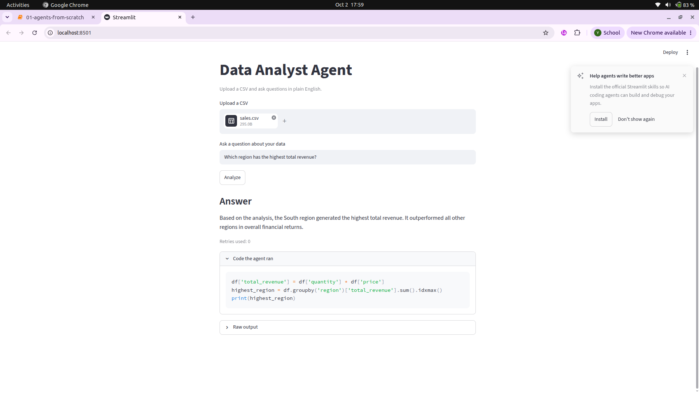

# Data Analyst Agent

A LangGraph agent that answers plain-English questions about a CSV file. It writes pandas code, runs it in a separate process, reads any error, and fixes its own code until it works or hits a retry limit.

## How it works

inspect data -> generate code -> execute -> (error?) -> fix code -> back to execute. When the code succeeds, or the retries run out, it goes to explain result.

- **inspect**: summarizes the CSV (columns, types, missing values, sample rows) so the LLM does not guess column names.
- **generate**: the LLM writes pandas code for the question.
- **execute**: checks the code against a denylist (blocked imports, file writes, eval), then runs it in a subprocess with a 15-second timeout.
- **result check**: empty output, NaN, or an empty table counts as a failure even if no exception was raised.
- **fix**: the error goes back to the LLM, which rewrites the code. The retry count is kept in the graph state, and the loop stops after 3 attempts with an honest failure message.
- **explain**: turns the raw output into a plain-English answer.

## Evaluation

Tested on a small 8-row sales CSV, with answers calculated by hand.

- Basic set: 9/9 correct
- Harder set (filters, averages, combined conditions): 4/4 correct
- Model: gemini-3.5-flash-lite

A request to save a file was blocked by the safety check. The agent retried 3 times, then stopped and reported that it could not complete the task.

## Limitations

- The safety check is a denylist plus a subprocess timeout. It is not a real sandbox. A production version would run code in a container.
- The test data is tiny and the questions are simple, so the scores show the loop works but say little about messy real-world files.
- No charts and no memory of earlier questions yet.
- Uses a free-tier LLM API, so use only dummy or public data.

## Run it

    pip install langgraph pandas python-dotenv google-genai streamlit
    echo "GEMINI_API_KEY=your_key" > .env
    streamlit run app.py

Evaluation: `python3 eval.py` and `python3 eval_hard.py`.

## Files

- `agent.py`: graph, state and nodes
- `runner.py`: safety checks and code execution
- `summary.py`: dataset summary
- `llm.py`: LLM call with retries
- `app.py`: Streamlit UI
- `eval.py`, `eval_hard.py`: test questions with known answers
